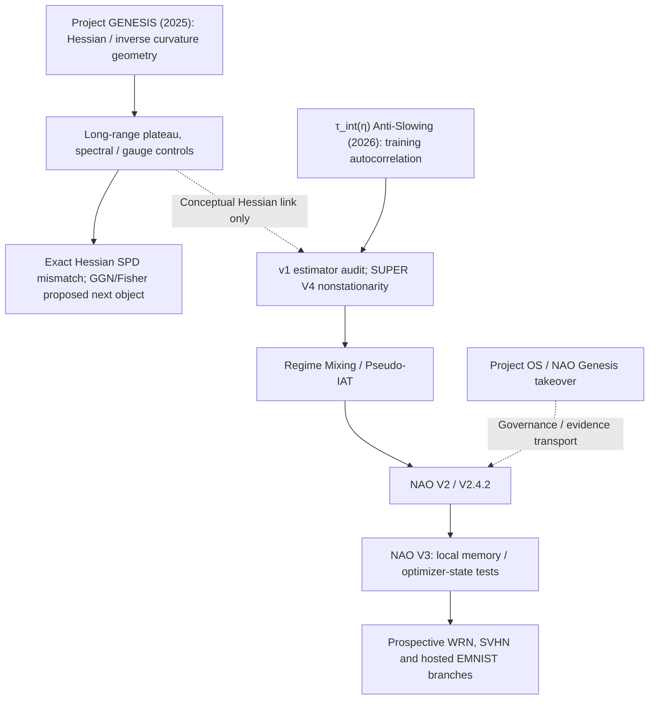

# Research genealogy and dependency map

## Two science roots, one direct successor chain

| Line | Research question | Relation |
|---|---|---|
| Project GENESIS | Can inverse neural-network curvature have a genuine, reproducible non-decaying layer-separated structure beyond spectral/gauge nulls? | Independent origin, **not** a direct parent of NAO |
| τ_int(η) | Does a near-instability training regime show anomalously reduced global estimated IAT? | Early empirical problem; original mechanism de-scoped |
| Regime Mixing | What does global adaptive ACF/IAT measure on a nonstationary trajectory? | Direct successor to Anti-Slowing audit |
| signed-Sokal | What happens to the actual random adaptive first-crossing estimator near tangency/boundary cases? | Mathematical offshoot of Regime Mixing |
| NAO V2 | Can global pseudo-IAT be reconstructed in natural neural-network training under precommitted tests? | Empirical methodology successor |
| NAO V3 | Is local/optimizer-dependent memory predictive across tasks and conditions beyond robust baselines? | Newer, more stringent program; negative controls matter |
| WorkBuddy four-track pilot | Joint new falsification program for GENESIS, NAO V3, Anti-Slowing and signed-Sokal | Separate 2026-10 validation layer, not confirmation of historical claims |
| Project OS | Claim ledger, execution control, authority, audit and source freeze | Infrastructure, not a scientific hypothesis |

## Key non-equivalences

1. The Hessian inverse in parameter space is not a global IAT measured from a nonstationary temporal observable.
2. An unstable or indefinite exact Hessian does not establish a universal law of long-range coupling.
3. Apparent Anti-Slowing in full trajectories is not an established intrinsic, stationary width transition.
4. The "GENESIS_RECONSTRUCTION_REPORT" of NAO administration refers to project takeover, not the original Hessian Project GENESIS.
5. The October 2026 WorkBuddy **new** pilot is distinct from 2025 GENESIS Phase V/Rev4, 2026 summer SUPER V4, and NAO ResNet G1.

## Chronology

- 2025-12: GENESIS early ReLU/DLN studies, long-range plateau, low-rank spectral hypotheses; Rev4 establishes weakly damped exact Hessian often indefinite and unsuitable for SPD precision-matrix interpretation.
- 2026-06–07: early τ_int flat result invalidated by estimator/data issues, then near-boundary global decrease observed under repaired procedures.
- 2026-07–08: SUPER V4 documents pervasive early/late heterogeneity; width mechanism downgraded; Regime Mixing and signed-Sokal program born.
- 2026-08: R5–R7 historical reconstruction; NAO V2.4.2 ResNet G1 strong global reconstruction but fails fixed-locality acceptance.
- 2026-08–09: NAO V3 scales/local clock/optimizer-state work; original WRN self-hosted run canceled; SVHN proposals and hosted EMNIST branch.
- 2026-10-22–26: WorkBuddy **four-track** synthetic pilot and follow-up checks: two computation-verified original runs, two original producer failures, and no confirmation of the four promotional core claims.

See the [newer status](SCIENCE_STATUS_20261026.md), [source registry](SOURCE_REGISTRY.csv), and historical [Regime Mixing source index](SOURCE_REGISTRY.csv).
